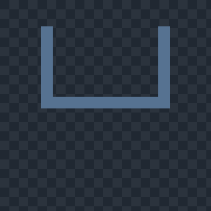

# パーティクル演出（SYNC_ParticleFX）

雨・雪・水しぶきなどを描き、画像のアルファ輪郭への衝突・付着・蓄積を表現するAviUtl2用フィルタープラグインです。Delphi / Direct2Dで実装し、共通の粒子計算と描画を通常のEXEからも利用できます。

| 項目 | 内容 |
| --- | --- |
| プロジェクト名 | SYNC_ParticleFX |
| プラグイン名 / グループ | パーティクル演出 / SYNC |
| 対象 | Windows 64bit / AviUtl2 2.1.16以降 |
| 開発環境 | Delphi 37.0 / Win64 |

## 機能

- 雨、雪、水をかける、花びら、落ち葉、紙吹雪、砂、ひょう、噴水、光の粒、インク、スライムの12スタイル。
- 連続・発射・爆発／放射・噴出の4方式と、全方向の発生・重力・風。
- 突風、滑らかな乱流、渦回転、空気抵抗、速度制限。
- アルファ輪郭への接触、面の向きに応じた反射・飛散、重力と傾斜に応じた蓄積。
- シードと時刻に基づく再現、途中フレームへのシーク、接触・蓄積だけの描画。

## インストール

配布ZIPを展開し、中の `SYNC_ParticleFX` フォルダーをAviUtl2の `Plugin` フォルダーへコピーします。標準の配置先は `C:\ProgramData\aviutl2\Plugin\SYNC_ParticleFX` です。更新前にAviUtl2を終了してください。

プラグイン本体は `SYNC_ParticleFX.auf2` です。同梱のREADME・LICENSE・THIRD_PARTY_NOTICES.md・ThirdParty内のSDKライセンスも一緒に配置します。

## 使い方とプリセット

1. 画像オブジェクトへ「SYNC」グループの「パーティクル演出」を追加します。
2. 「スタイル」で雨・雪・水などの素材を選びます。
3. 一番上の「プリセット」で候補を選び、直下の「適用」を押します。
4. 発生量、初速度、角度、風、重力、蓄積量などを個別に調整します。

選択だけでは演出は変わりません。ボタンを押すと、発生量・大きさ・速度・発生方式・継続時間・方向・重力・風・突風・乱流・渦・揺れ・発光などの関連項目へ値を一括設定します。適用後は表示された各項目の値で描画し、プリセットを裏側から再適用しません。

別のプリセットを適用すると、関連項目をそのプリセットの値へ置き換えます。「標準」を適用すると現在のスタイルの基準へ戻せます。位置・開始時刻・開始状態・シード・色・接触・蓄積・描画範囲の個別設定は維持します。旧版でプリセットを選択済みのプロジェクトでは、必要な候補を改めて適用してください。

開発旧版からは項目名を短縮しています。名前を変更した項目は旧プロジェクトから値を引き継がないため、必要な値を再設定してください。

| 目的 | プリセットの例 |
| --- | --- |
| 雨・雪 | 小雨・少量、豪雨・大量、横殴り・横風、暴風雨・吹雪、嵐・猛吹雪、霧雨・粉雪、牡丹雪 |
| 花びら・落ち葉・砂 | 風に流される、舞い上がる、渦巻き・竜巻、砂嵐 |
| 水の発射・噴出 | バケツ、強い水流、シャワー、間欠噴出、連続噴射 |
| 特殊な運動 | 無重力、全方向放射、爆発 |
| 粘性のある液体 | スライム、さらさら、ねばねば |

「牡丹雪」は雪、「バケツ」「強い水流」は水をかける、「シャワー」「間欠噴出」「連続噴射」は噴水、「全方向放射」「爆発」は光の粒、「砂嵐」は砂へスタイルも切り替えます。量・風などの共通プリセットは選択中のスタイルへ適用します。

## 開始状態

「時間補正」の下にある「開始状態」で、表示開始時の進み具合を0～100で指定します。初期値100は従来の表示です。

| 値 | 開始時の表示 |
| --- | --- |
| 0 | 粒子・付着・蓄積のない状態から始まる |
| 50 | 途中まで進んだ状態から始まる |
| 100 | 予備動作を済ませた従来の状態から始まる |

雨・雪・スライムなどの連続型では、速度・重力・画像サイズから求める予備動作の時間へ割合を掛けます。0から始めた雪の蓄積は時間とともに設定量へ育ち、スライムの付着は接触した粒子の履歴から生まれます。

「予備動作」は従来どおり、0で自動、-1でなし、正数で基準秒数を指定する詳細設定です。「開始状態」はその事前計算量を調整します。「時間補正」は表示時刻全体を秒数でずらすため、先の時刻へ補正すれば開始状態0でも進んだ状態を表示します。

発射・爆発・噴出の発生時刻は維持します。プリセットを適用しても開始状態は変更しません。

「開始」で時刻を指定した連続型は、その時刻に選んだ開始状態で粒子が現れます。

[雨・雪・スライムの0／50／100比較](Sample/start_state.png)

## 方向・接触・蓄積

「角度」の0はスタイルの基準方向です。雨・雪などは下、水をかける・インクは右、噴水は上が基準です。重力角は0で下、風向は0で右です。重力0で無重力になります。

連続型の発生位置を自動にすると、進行方向の反対側から流入します。発射・爆発・噴出の位置は「位置X/Y」で調整できます。座標の原点は画像中央です。寿命0はスタイル既定、予備動作0は自動、-1は予備動作なしです。

接触対象はこのフィルターへ渡される画像のアルファです。別オブジェクトの形状を直接参照しません。蓄積量は0～100で、0なら蓄積を描きません。雪などは重力に面する輪郭を優先し、横風がある場合は風上側にも薄く付着します。雨・水・光には厚い蓄積を作りません。

「表示方式」は合成・粒子・接触／蓄積から選びます。全画面の雪と人物への積雪を併用する場合は、人物側を接触／蓄積のみにすると空中粒子の重複を避けられます。

描画範囲は入力画像と「下余白」を合わせたサイズです。範囲外の粒子・積雪はクリップされます。通常の生成粒子は12,000、飛散を含む描画要素は72,000、スライムは2,048粒、画像は16,777,216画素を上限にしています。

## スライム・粘度

プリセットで「スライム」「さらさら」「ねばねば」を選んで「適用」を押すと、スタイルと関連項目が切り替わります。「接触」内の項目で粘りを調整できます。

| 項目 | 動作 |
| --- | --- |
| 粘度 | 近い粒子同士の速度差をならし、表面に沿う動きを粘らせる |
| まとまり | 近い粒子を引き寄せ、描画でも粒の間をつなげる |
| 付着力 | 画像の輪郭に沿って留まる強さ |
| 滴下時間 | 接触してから前面へ垂れ落ちるまでの基準時間 |
| 蓄積量・厚さ | 接触部に溜まる液体の厚み。溜まった粒子も移動を続ける |
| 下余白 | 入力画像の下に追加する透明な描画領域 |

斜面では輪郭に沿って流れ、くぼみでは滴下時間・粘度・付着力・蓄積量に応じて一時的に溜まった後、画像の前面を通って下へ流れます。画像を2Dの接触面として扱う演出用の粘性粒子モデルです。重力0では自動的な下向き滴下を行いません。

元画像の下端より先まで表示したい場合は「出力」の「下余白」を増やしてください。元画像の配置と床位置を維持して下へ拡張し、高さ8,192・総画素数の上限で制限します。プリセットを適用しても下余白は維持します。

粘性粒子は全体の履歴を固定刻みで計算します。近い時刻はキャッシュを利用し、逆シークや初回表示も同じ結果を再現します。遠い時刻への初回シークは、通常の雨・雪より計算に時間が掛かります。



[人物・輪・段差・斜面での動画見本](Sample/slime_person_demo.gif)も用意しています。

## ソースからのビルド

Delphiで `SYNC_ParticleFX.dproj` を開き、Win64のDebugまたはReleaseをビルドします。既存のビルド設定により `C:\ProgramData\aviutl2\Plugin\SYNC_ParticleFX\SYNC_ParticleFX.auf2` へ出力します。PhotoShotから引き継いだビルドイベントを維持しています。コマンド・コメント・文字コードの共通ルールは [note.md](note.md) にあります。

| 場所 | 役割 |
| --- | --- |
| Source/Common | ホスト非依存の設定・粒子計算・接触・Direct2D描画 |
| Source/Plugin/Filter | AviUtl2標準項目・プリセット適用・画像の入出力 |
| Source/Lib | SDK型定義とフィルターテーブル登録 |
| Experiments | 通常のEXEによる画像生成・描画の検証 |
| Sample/base.png | 接触・積雪の確認用透過ベース画像 |
| setup | 配布ZIP作成バッチ・カタログJSON・利用者向けREADME |

## AviUtl2なしでの描画確認

[実験用プロジェクト](Experiments/README.md)はSDKやプラグインDLLを参照しない通常のEXEです。透過素材を生成し、共通の描画器でPNGとGIFを出力します。

```powershell
cmd /c 'call "C:\Program Files (x86)\Embarcadero\Studio\37.0\bin\rsvars.bat" && msbuild Experiments\ParticleFX_Experiment.dproj /t:Build /p:Config=Debug /p:Platform=Win64'
.\Win64\Experiment\ParticleFX_Experiment.exe
```

接触法線・1pxの障害物・アルファ合成・逆シーク・蓄積量・全方向の運動などを確認します。AviUtl2標準項目の操作確認はホスト上で別途行います。

## 配布ZIPとGitHub

Releaseをビルドした後に `setup\make_release_zip.bat` を実行すると、`setup\SYNC_ParticleFX.zip` を作成し、`setup\SYNC_ParticleFX.catalog.json` の末尾バージョンへAUF2のXXH3-128を記録します。必要なツールと手順は [setup/README.md](setup/README.md) を参照してください。

バッチは既存のAUF2を梱包します。GitHub公開時は同じ版のソースをタグへ保存し、ZIPをReleaseへ添付します。Win64、中間バイナリ、生成ZIPはGitの追跡対象から除外しています。

## ライセンス

Copyright (c) 2026 VRAMの魔術師

本体のソースコードはコピー元と同じGNU General Public License v3.0（GPL-3.0-only）です。全文は [LICENSE](LICENSE)、移植元とSDKの表記は [THIRD_PARTY_NOTICES.md](THIRD_PARTY_NOTICES.md) にあります。AviUtl ExEdit2 Plugin SDK由来の定義にはMITライセンスの著作権表示を同梱します。
